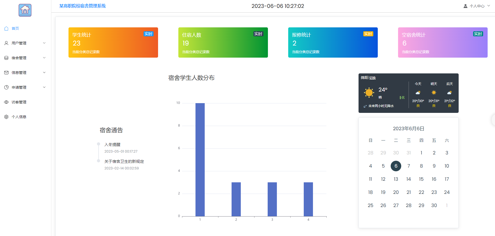
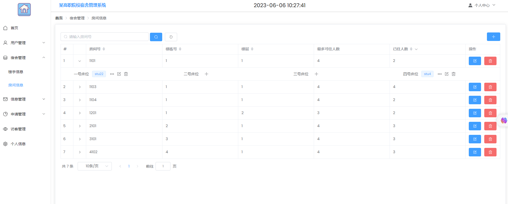
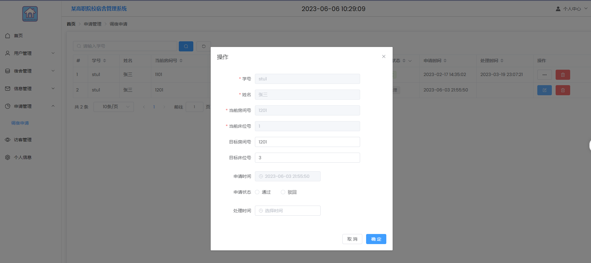
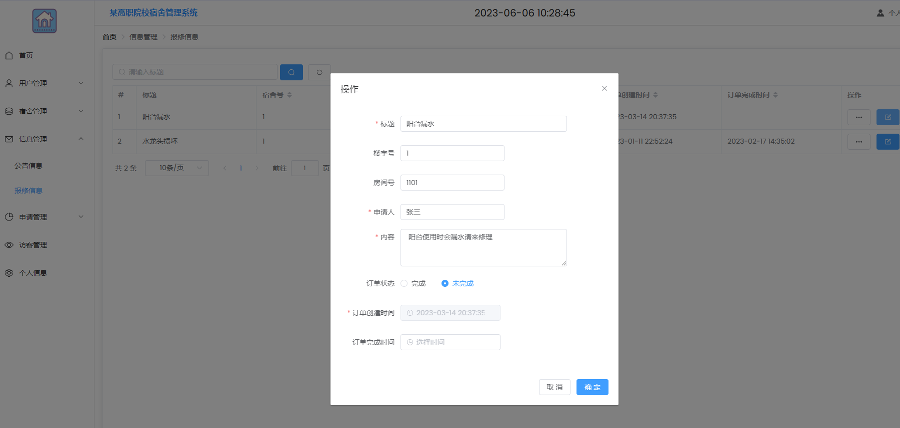

# 宿舍管理系统

基于 Spring Boot 和 Vue 3 的前后端分离项目，包含学生入住、房间分配、调宿审批、报修、公告和访客登记。可以用来学习 Java Web 开发，也可以作为毕业设计的参考。

[快速启动](#快速启动) · [演示账号](#演示账号) · [开发与测试](#开发与测试) · [常见问题](#常见问题)

## 功能

| 身份 | 可以做什么 |
| --- | --- |
| 后勤管理员 | 管理学生、宿管、楼宇和房间，分配床位，审批调宿，处理报修，发布公告，登记访客 |
| 宿舍管理员 | 查看和管理本楼的学生、房间、报修、调宿及访客记录 |
| 学生 | 查看自己的宿舍，提交调宿和报修申请，修改个人信息和密码 |

首页提供学生人数、入住人数、报修数量和未满房间统计，附带公告、日历、天气和入住分布图。天气组件需要单独配置第三方服务，不影响其他功能启动。

学生只能查看本人的业务记录；宿管按所属楼宇管理。密码使用 BCrypt 保存。床位分配和调宿审批放在事务中处理，重复入住、床位争抢或过期页面提交会被拒绝。

## 页面截图



<details>
<summary>查看房间分配、调宿和报修页面</summary>





</details>

截图沿用早期版本，部分字段和操作以当前代码为准。

## 技术栈

| 部分 | 主要依赖 |
| --- | --- |
| 后端 | Java 11、Spring Boot 2.6.3、Spring Security、MyBatis-Plus 3.5.1 |
| 数据库 | MySQL 8.0 |
| 前端 | Vue 3.2.31、Element Plus 2.0.1、Vue Router、Vuex、ECharts |
| 构建 | Maven 3.6+、Node.js 22、npm 10、Vue CLI 4 |

前端使用较早版本的 Webpack，启动脚本已处理 Node 22 的 OpenSSL 兼容问题。请使用仓库中的锁文件安装依赖。

## 快速启动

下面以 Windows PowerShell 为例。先安装 JDK 11、Maven、Node.js 22 和 MySQL 8.0，再拉取代码：

```powershell
git clone https://github.com/NiToot/DormitoryManagementSystem.git
Set-Location DormitoryManagementSystem
```

默认端口为：MySQL `13306`、后端 `9090`、前端 `8080`。如果本机 MySQL 使用其他端口，同时修改连接命令和后端的 `DB_PORT`。

### 1. 创建演示数据库

从仓库根目录连接你准备用于本项目的 MySQL 实例：

```powershell
mysql --host=127.0.0.1 --port=13306 --user=root --password --default-character-set=utf8mb4
```

在 MySQL 客户端执行：

```sql
SOURCE database/init.sql;
CREATE USER 'dormitory'@'127.0.0.1' IDENTIFIED BY '替换为自己的数据库密码';
GRANT SELECT, INSERT, UPDATE, DELETE ON dormitory_demo.* TO 'dormitory'@'127.0.0.1';
```

账号已存在时跳过 `CREATE USER`，确认密码及授权即可。初始化脚本会创建 `dormitory_demo` 库、所需表和虚构的演示数据；重复导入不会覆盖已有记录，也不会升级旧表结构。

已有旧版数据库的升级方法见 [认证与密码迁移](docs/security-baseline.md) 和 [住宿数据迁移](docs/accommodation-consistency.md)。不要用演示初始化脚本代替迁移。

### 2. 启动后端

在仓库根目录打开 PowerShell，设置当前窗口的环境变量：

```powershell
$env:JAVA_HOME = '你的 JDK 11 安装目录'
$env:Path = "$env:JAVA_HOME\bin;$env:Path"
$env:DB_PORT = '13306'
$env:DB_USERNAME = 'dormitory'
$env:DB_PASSWORD = '上一步设置的数据库密码'

Set-Location Dormitory_business
mvn -s .mvn/settings.xml package
java -jar target/Dormitory_bussiness-1.0.0.jar
```

打包时会运行测试，需要先完成数据库初始化。出现 `Started SpringbootApplication` 后，后端开始监听 `127.0.0.1:9090`。保持这个窗口运行。

数据库地址默认是 `127.0.0.1`，库名默认是 `dormitory_demo`。需要调整时设置 `DB_HOST`、`DB_NAME`；后端端口使用 `SERVER_PORT`。用户名和密码没有默认值。

也可以使用 [外置配置示例](Dormitory_business/src/main/resources/application-example.properties)。将个人配置放在仓库根目录的 `.runtime` 中，并在启动时通过 `--spring.config.additional-location=file:../.runtime/application-local.properties` 加载；这个目录不会提交到 Git。

### 3. 启动前端

再打开一个 PowerShell 窗口，从仓库根目录执行：

```powershell
Set-Location vue
npm.cmd ci
npm.cmd run serve
```

打开 [http://127.0.0.1:8080/Login](http://127.0.0.1:8080/Login)，选择身份后登录。开发服务器会将 `/api` 请求转发到后端。

如果更改了后端端口，把 [vue/.env.example](vue/.env.example) 复制为 `vue/.env.local`，修改 `VUE_APP_API_TARGET`，然后重启前端。

## 演示账号

| 登录身份 | 账号 | 密码 |
| --- | --- | --- |
| 后勤管理中心 | `admin01` | `Demo123456` |
| 宿舍管理员 | `dorm01` | `Demo123456` |
| 学生 | `20230001`、`20230002`、`20230003` | `Demo123456` |

前两名学生住在 `1001` 房间，第三名学生尚未分配宿舍。可以先用管理员账号分配床位，再用学生账号体验报修和调宿。

这些账号和密码是公开的，只用于本地演示，请勿填入真实学生资料。

## 开发与测试

```text
Dormitory_business/    Spring Boot 后端
vue/                   Vue 前端
database/              初始化 SQL 和旧版迁移脚本
scripts/               本地接口检查脚本
docs/                  权限、事务、富文本处理及测试说明
doc/img/               页面截图
```

后端测试：在配置好数据库环境变量的窗口中，进入 `Dormitory_business` 执行 `mvn -s .mvn/settings.xml test`。测试使用 `dormitory_demo`，包含登录权限、个人数据隔离、床位竞争、调宿回滚和富文本处理。只连接专用演示库。

前端构建：在 `vue` 目录执行 `npm.cmd run build`，输出到 `vue/dist`。部署时还需配置 `/api` 反向代理和 Vue history 路由回退。

前后端启动后，可在仓库根目录的 PowerShell 7 中运行 `./scripts/smoke-test.ps1`，检查三种身份登录、会话、主要接口和前端代理。

进一步阅读：[认证与权限](docs/security-baseline.md) · [住宿事务与并发](docs/accommodation-consistency.md) · [富文本处理](docs/rich-text.md) · [测试记录](docs/local-verification.md)

## 常见问题

**数据库连不上**：确认 MySQL 已启动，端口、库名、账号和密码与环境变量一致。项目不会在启动时自动导入 SQL。

**Maven 下载失败**：项目的 `.mvn/settings.xml` 使用 HTTPS Maven Central。公司网络需要私有镜像时，换成自己的 settings 文件。

**前端报 `ERR_OSSL_EVP_UNSUPPORTED`**：使用 `npm.cmd run serve` 或 `npm.cmd run build`，不要绕过项目脚本直接调用 Webpack。

**8080 端口被占用**：可运行 `npm.cmd run serve -- --port 18080`。同时在后端外置配置的 `app.allowed-origins` 中加入 `http://127.0.0.1:18080` 并重启后端。

**旧版数据库升级后无法登录**：先完成增量 SQL 和密码迁移。后端不再接受明文密码，单独重新导入 `init.sql` 不能完成升级。

**保存公告后样式或图片消失**：公告只保留文字、常用排版、表格和 HTTP(S) 链接。图片、视频、脚本及自定义样式会被移除，详见 [富文本处理](docs/rich-text.md)。

## 后续改进

目前仍采用每间房四个床位字段的设计，住宿写入共用数据库协调锁。后续计划拆分入住关系表，改用更细的锁和数据库唯一约束，并逐步更新旧依赖、补充登录限流、操作审计和上传文件清理。

项目适合本地学习。若用于实际宿舍管理，还需处理 HTTPS、备份、账号策略及真实数据迁移。仓库暂未提供 LICENSE。

发现问题可以提交 [Issue](https://github.com/NiToot/DormitoryManagementSystem/issues)，附上操作步骤、环境版本和错误摘要；日志中的密码、密钥和个人资料请先删除。
