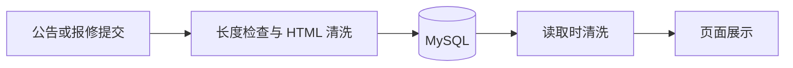

# 公告与报修的富文本处理

公告编辑器和报修详情会显示 HTML。为避免粘贴内容或直接请求接口时带入脚本，后端统一使用 jsoup 的白名单清洗。

## 保留哪些内容

- 段落、换行、标题、粗体、斜体、下划线、删除线。
- 列表、引用、代码、表格。
- 完整的 `http://`、`https://` 链接及链接标题；链接补充 `nofollow noopener noreferrer`。

图片、视频、iframe、SVG、MathML、表单、脚本、自定义样式、事件属性和其他协议的链接不会保留。相对链接和 `//` 开头的链接也不会保留地址。公告编辑器的工具栏只提供支持的格式；从外部粘贴的排版可能因此简化。

新增或修改的内容最多 20,000 个 UTF-16 字符（包含 HTML 标签，表情等字符可能占两位）。超出后接口返回 HTTP 400，不保存记录。

## 写入与读取

`RichTextSanitizer` 集中定义规则，`NoticeServiceImpl`、`RepairServiceImpl` 在新增和修改时清洗内容。查询列表、个人报修及首页公告时再次清洗，避免旧版数据库中的 HTML 直接进入页面。

读取不会修改数据库，也不会截断旧记录。仅更新报修状态、未传 `content` 时，原内容保持不变；下次读取仍按上述规则处理。此次改动无需执行 SQL 迁移。



## 回归检查

`RichTextBoundaryTests` 使用本机演示库，覆盖公告及报修的新增、修改、旧数据读取、超长输入和不修改内容的状态更新。测试事务结束后回滚。

`RichTextSanitizerTests` 不依赖数据库，覆盖编码后的危险协议、图片事件、iframe、SVG、MathML、常用排版、空值和长度边界。

在 `Dormitory_business` 目录运行全部测试：

```shell
mvn -s .mvn/settings.xml test
```

只运行清洗规则测试：

```shell
mvn -s .mvn/settings.xml -Dtest=RichTextSanitizerTests test
```

规则参考：[jsoup 官方清洗说明](https://jsoup.org/cookbook/cleaning-html/safelist-sanitizer)。本改动不涉及其他字段、头像上传或完整依赖升级。
